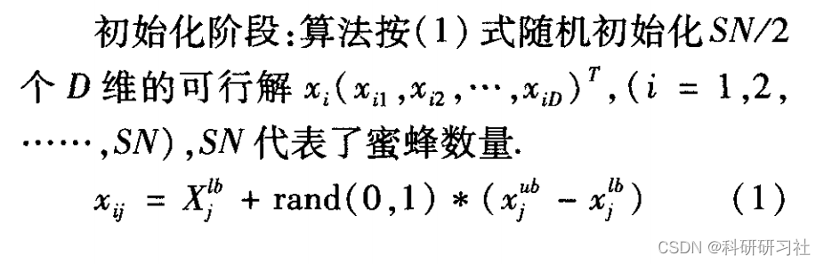
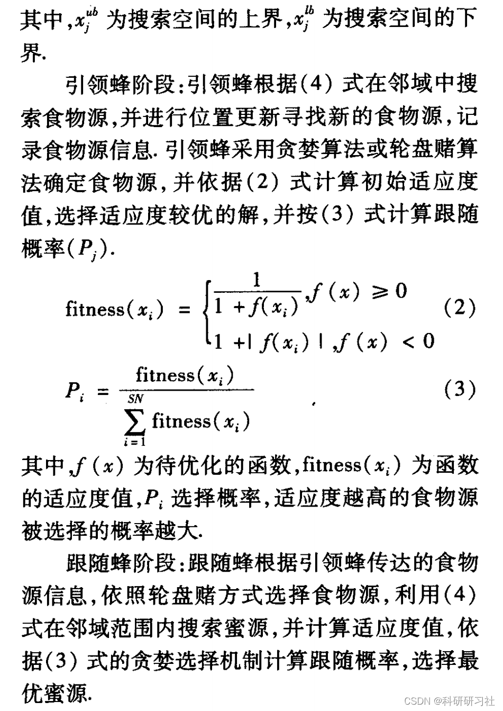
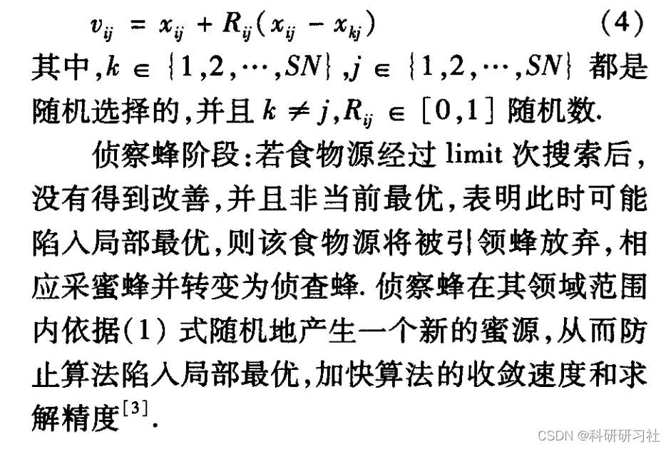
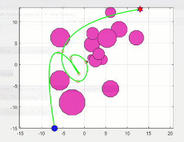
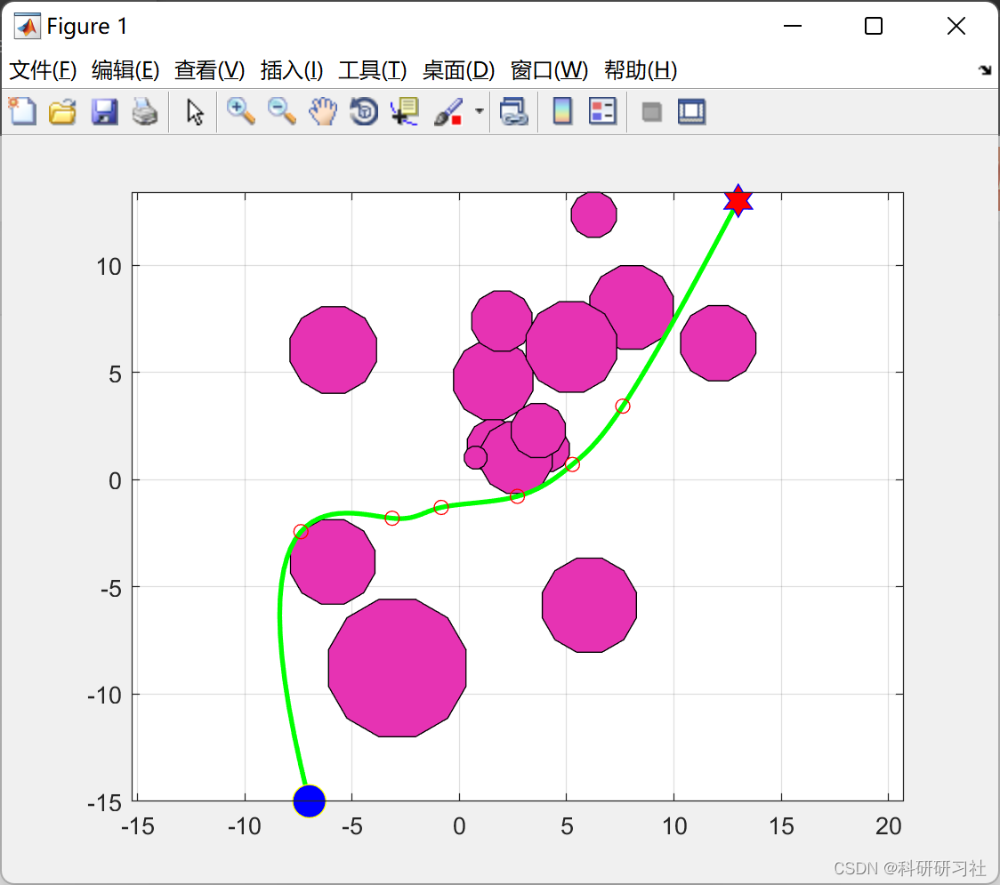
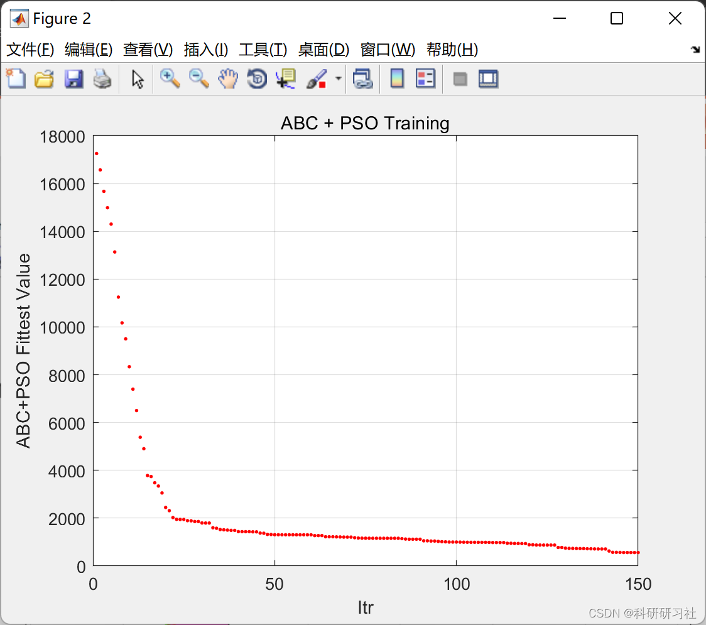

# Combination of Artificial Bee Colony (ABC) Algorithm and Particle Swarm Optimization Algorithm for Path Optimization Problem (Matlab Code Implementation)

1. Overview of the Traveling Salesman Problem is a typical NP-Hard problem. Due to the inefficiency of classical algorithms in solving larger scale combinatorial or highly nonlinear optimization problems. In recent years, many metaheuristic algorithms for solving the traveling salesman problem have been proposed, mainly including neural networks (Neural Network), simulated annealing (Simulated Annealing, SA), genetic algorithms (Genetic Algorithms, GA), ant colony optimization algorithm (Ant Colony Optimization, ACO), particle swarm optimization algorithm (Particle Swarm Optimization, PSO), artificial bee colony algorithm 1 (ABC, Artificial Bee Colony Algorithm) and a series of other intelligent group algorithms. The ant colony algorithm is a relatively new intelligent group algorithm that simulates the honey-collecting behavior of natural bees. Bees use the swing dance to locate the best food source and search for new food sources. Based on the foraging behavior of the swarm of bees, the ant colony algorithm with positive feedback mechanism of finding the optimal solution has strong convergence and robustness. Applying the ant colony algorithm to path optimization problems provides a new approach with certain research significance.
This paper solves the path optimization problem based on the combination of artificial bee colony (ABC) algorithm and particle swarm optimization algorithm, and realizes it using MATLAB code. 2. Basic Artificial Bee Colony Algorithm Professor Karaboga from Erciyes University in Turkey proposed a new intelligent optimization algorithm in 2005 in the literature [1]. The algorithm includes three basic elements: employed bees, non-employed bees, and food sources.
Employed bees: also known as leading bees, store information about food sources and return to the hive after collecting nectar through the swing dance form, their number equals the number of food sources.
Non-Employed Bees: There are two types of bees, following bees and scout bees. Following bees choose whether to follow the dance of the leading bee according to a roulette wheel method after observing the dance.
Food Source: The search target for bees. In the algorithm, the quality of the food source is proportional to its profitability; scout bees mainly discover new food sources to break out of local optima.
Editor
Editor
Editor
3 Particle Swarm Optimization Algorithm (with Constraint Handling) - Python & Matlab Implementation
4 Run Results
Editor
Editor
Editor
5 Matlab Code Implementation: This article only displays part of the code. For the complete code, click the link: Combining Artificial Bee Colony (ABC) Algorithm and Particle Swarm Optimization Algorithm for Path Optimization Problems (Matlab Code Implementation)
\nfunction Plotting(sol,model)\n\n    xs=model.xs;\n    ys=model.ys;\n    xt=model.xt;\n    yt=model.yt;\n    xobs=model.xobs;\n    yobs=model.yobs;\n    robs=model.robs;\n    \n    XS=sol.XS;\n    YS=sol.YS;\n    xx=sol.xx;\n    yy=sol.yy;\n    \n    theta=(1/24:1/12:1)'*2*pi;\n    for k=1:numel(xobs)\n        fill(xobs(k)+robs(k)*cos(theta),yobs(k)+robs(k)*sin(theta),[0.9 0.2 0.7]);\n        hold on;\n    end\n    \n\n% figure;\n    plot(xx,yy,'g','LineWidth',2);\n    plot(XS,YS,'ro');\n    plot(xs,ys,'yo','MarkerSize',14,'MarkerFaceColor','b');\n    plot(xt,yt,'bh','MarkerSize',14,'MarkerFaceColor','r');\n    hold off;\n    grid on;\n    axis equal;\n\nend\n  
6. References
[1] Zhang Pinghua, Jia Wanxiang, Xu Jing, Hu Jun. Improving the Application of Artificial Bee Colony Algorithm in Path Optimization [J]. Harbin Normal University Natural Science Journal, 2017, 33(3):8-12
[2] Zhao Ying, Meng Xiang, Li Yanjuan, Wang Yifan, Zhao Yanchao. Artificial Bee Colony Optimization Non-Robust Path Delay Fault Test Generation Algorithm [J]. Heavy Machinery, 2015, 0(4):18-22

## Images

<!-- PAYMENT_BLOCK -->

## Get this dataset

- Payment link (Stripe): [Buy now](https://buy.stripe.com/3cs8yP7sY87d0vu9AB)
- Payment QR code: 

<!-- /PAYMENT_BLOCK -->
